# 🌱 HabitFlow – Daily Habit Tracker (Flutter)

**HabitFlow** is a simple mobile app that helps students build good daily habits – drinking water,
studying, exercising, sleeping on time. Tick a habit off with one tap, keep your streak alive,
and watch your progress in a calendar heatmap and weekly chart. All data stays on the device.

> One-week technical project · **Bokka Meghana Reddy (24AG1A0509)** · Department of CSE, ACE Engineering College
> · Project guide: **Mr. P. Satish Bhasker** · 15/10/2026 – 21/10/2026

## ✨ Features

| Feature | Description |
|---|---|
| ✅ Today | Progress ring (x of y done), one-tap check-off, streak badge and last-7-days dots for every habit |
| 🔥 Streaks | Current streak, best streak and 30-day completion rate per habit |
| 📅 Heatmap | 5-week calendar heatmap on the habit details screen |
| ➕ New / edit habit | Name, category, 12 icons, 8 colours, optional note – with validation |
| 📊 Statistics | Last-7-days bar chart (CustomPainter) and a streak leaderboard |
| ⚙️ Settings | Dark mode, demo habits, reset all data |
| 💾 Offline storage | Habits and history saved with `shared_preferences` |

## 📱 Screenshots (live execution)

Captured from the running app (`flutter run -d web-server`, phone-size window 412 × 892).

| Empty state | Today (demo data) | Ticking habits | Statistics |
|:---:|:---:|:---:|:---:|
| 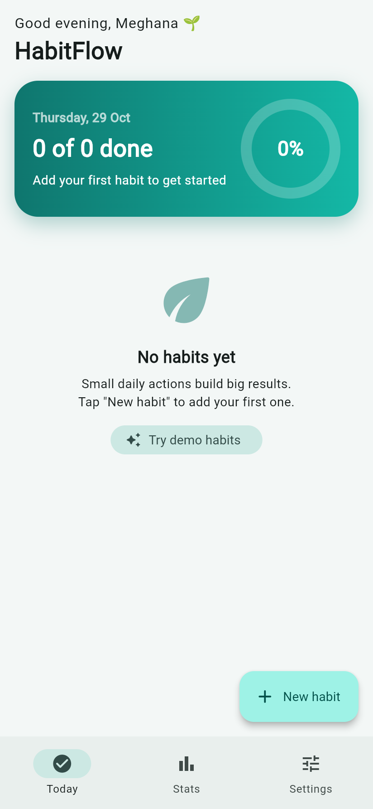 | 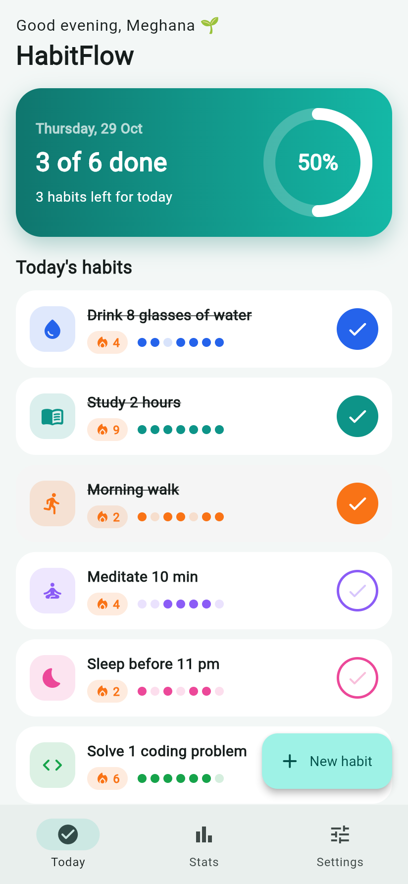 | 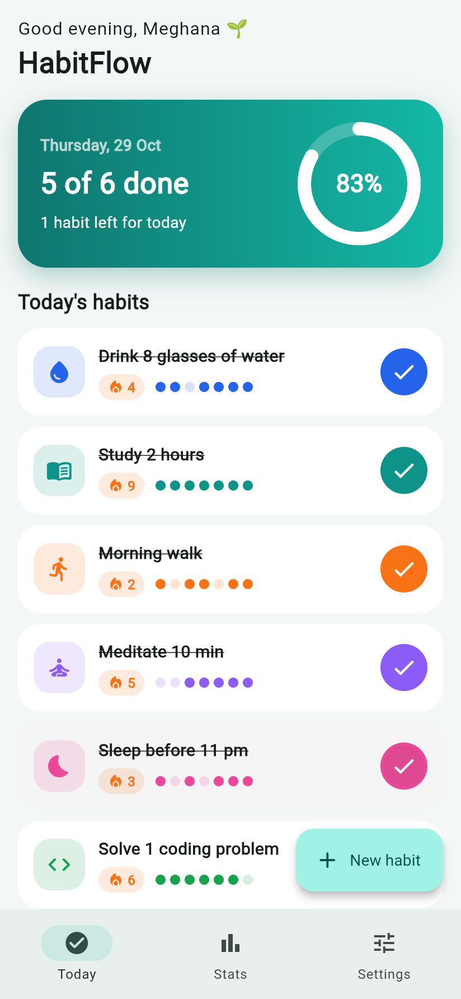 | 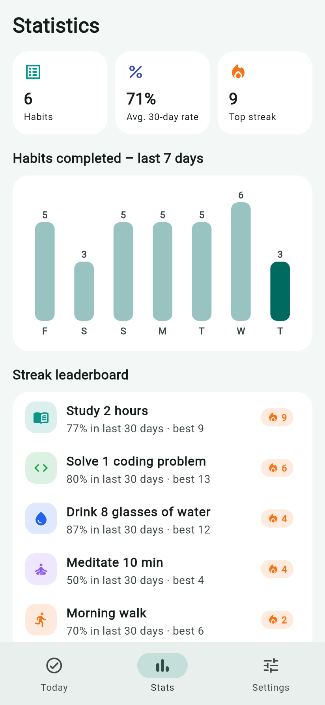 |

| Habit details & heatmap | New habit | Validation | Habit created |
|:---:|:---:|:---:|:---:|
| 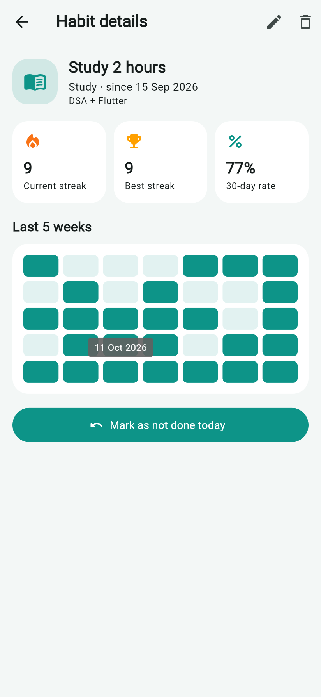 | 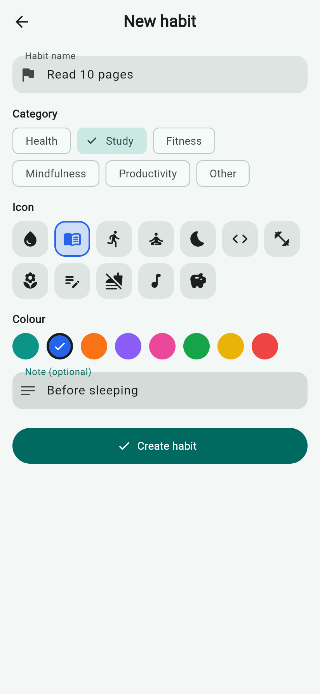 | 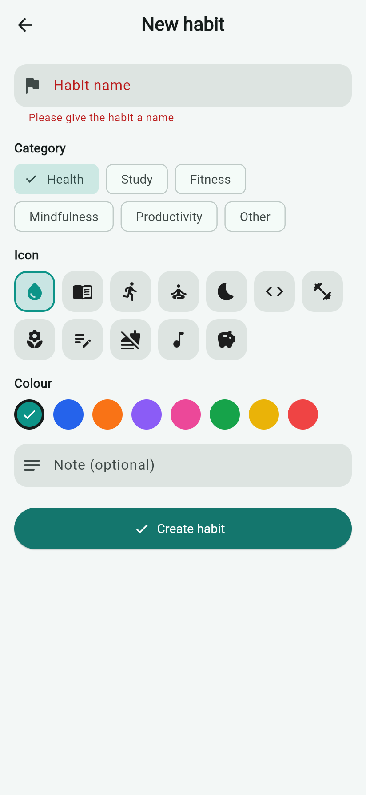 | 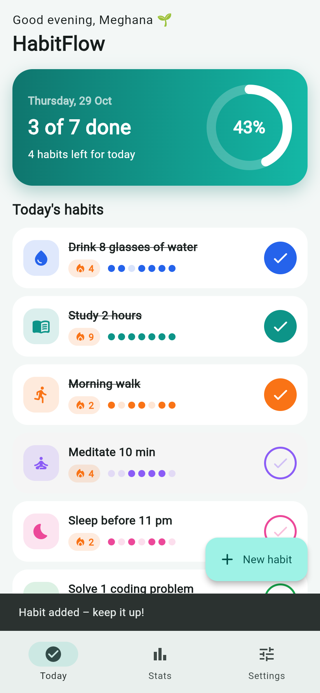 |

| Settings | Dark mode | Reset dialog |
|:---:|:---:|:---:|
| 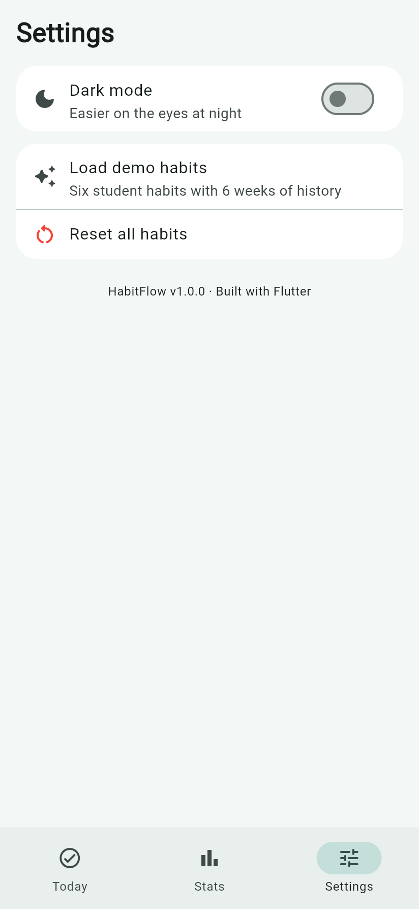 | 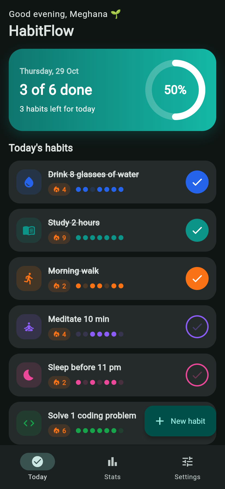 | 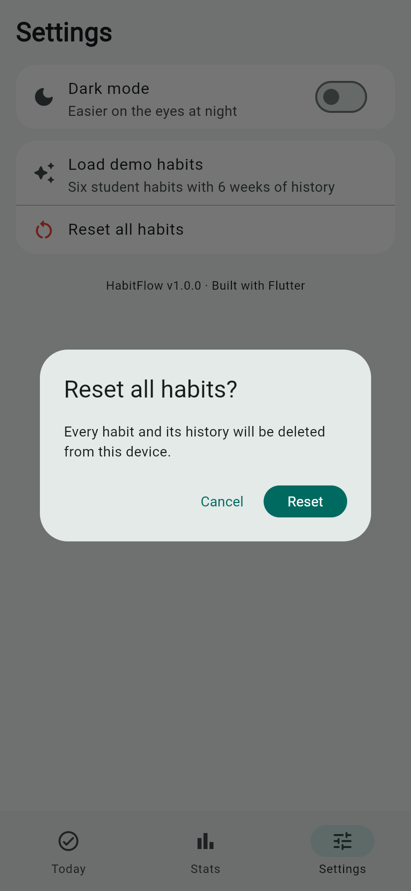 |

## 🏗️ Architecture

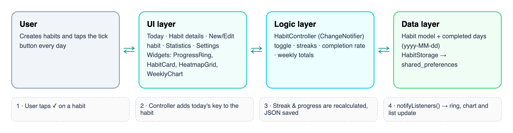

1. **UI layer** – screens (`lib/screens`) built from small widgets (`lib/widgets`), including a CustomPainter progress ring and bar chart.
2. **Logic layer** – `HabitController` (`ChangeNotifier`) toggles days, calculates streaks, rates and weekly totals; the UI rebuilds with `ListenableBuilder`.
3. **Data layer** – the `Habit` model stores completed days as `yyyy-MM-dd` keys and `HabitStorage` saves everything with `shared_preferences`.
